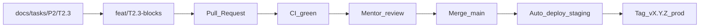
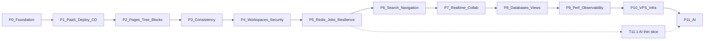

# Second Brain — роадмап v2

Notion-подобное приложение: страницы, блоки, workspaces, поиск, совместная работа, базы данных, публичный API; AI — тонким срезом после P5, полноценно — в P11.
Фокус: **Python и бэкенд** (≈70%), каждая фича видна на фронте (≈30%).

Предыдущий этап (уроки 1–19) — архив в `~/Work/Python/Backend/lessons/` и `Backend/PLAN.md`.
Стартовая точка кода — `lesson_19_auth_frontend` (переносится в задаче T0.1).

---

## 1. Как работаем

### Поток задачи



1. Одна задача — один файл: `docs/tasks/P<N>/T<N>.<номер>-<slug>.md`. В `docs/tasks/P<N>/README.md` — цель фазы и список задач.
2. Подробные ТЗ сейчас есть для P0–P3. Для P4–P11 — короткие карточки; подробное ТЗ пишется перед стартом фазы.
3. Ветка: `feat/T2.3-blocks`, `fix/...`, `chore/...`. Коммиты — [Conventional Commits](https://www.conventionalcommits.org/) (`feat(pages): ...`), ID задачи в описании PR.
4. PR по шаблону. CI обязан быть зелёным.
5. Ревью ментора: просишь в чате «ревью T2.3». Правки — в тот же PR.
6. После merge — автодеплой на staging (с P1). Релиз в prod — git tag.
7. Готовую задачу отмечаешь в таблице §4: `✅ T2.3`.

Размер задачи: **S** — вечер, **M** — 2–3 вечера, **L** — неделя.

### Контрольные точки и объём

Роадмап большой (~65 задач, из них ~25 размера L). При темпе 3–4 вечера в неделю это 1.5–2 года. Чтобы проект был полезен задолго до конца, есть три контрольные точки:

| Точка | После | Что уже можно показать |
| ----- | ----- | ---------------------- |
| **Demo-ready** | P4 | задеплоенный многопользовательский редактор страниц с правами и шарингом |
| **Portfolio-ready** | P6 + T11.1 + T9.1 | поиск, очереди, outbox, метрики, первая AI-фича со стримингом |
| **Полный продукт** | P11 | realtime, базы, публичный API + webhooks, RAG, агент, MCP-сервер |

Задачи, которые **не обязательны** для прохождения роадмапа (берутся по желанию, после контрольной точки «Portfolio-ready»): T7.4 CRDT, T8.C формулы, T10.2–T10.4 (переезд с PaaS на VPS), T4.C2 passkeys, все `challenge`.

Ориентир по длительности фазы при темпе 3–4 вечера в неделю: P0 — 3 нед, P1 — 2, P2 — 5, P3 — 4, P4 — 6, P5 — 6, P6 — 3, P7 — 5, P8 — 5, P9 — 4, P10 — 4, P11 — 8.

### Метки слоя

| Метка | Смысл |
| ----- | ----- |
| `backend` / `frontend` / `infra` | слой |
| `system-design` | практика согласованности, отказоустойчивости, масштабирования |
| `python` | акцент на языке (asyncio, typing, пакеты) |
| `challenge` | задача повышенной сложности, не блокирует фазу |

Технический долг и найденные баги записываются в `docs/tech-debt.md`.

### ADR

Значимое решение (выбор очереди, CRDT-библиотеки, хостинга, модели прав) — ADR в `docs/adr/NNNN-<slug>.md` по шаблону `0000-template.md`. ADR пишется в том же PR, где решение реализуется.

### Definition of Done (для каждой задачи)

- [ ] Критерии приёмки из карточки выполнены
- [ ] Бэкенд покрыт тестами (успех + ошибки); `pytest` зелёный
- [ ] `ruff check`, `ruff format --check`, `mypy` чистые
- [ ] Фронт: `npm run lint` + `npm run build` проходят; фича видна в UI
- [ ] Миграции Alembic обратимы (`downgrade` работает) или в PR объяснено, почему нет
- [ ] Нет секретов в git; новые env-переменные описаны в `.env.example`
- [ ] UI доступен с клавиатуры, есть состояния loading / empty / error
- [ ] README или `docs/` обновлены, если поменялся запуск или контракт
- [ ] С P1: задеплоено на staging и проверено руками

---

## 2. Структура репозитория (целевая)

```
second-brain/
  backend/
    pyproject.toml          # uv, ruff, mypy, pytest
    alembic/
    src/app/
      main.py               # create_app()
      core/                 # settings, logging, errors, db, security
      modules/
        auth/               # router.py, service.py, repository.py, models.py, schemas.py
        pages/
        workspaces/
        ...
      workers/              # фоновые задачи (с P5)
    tests/
  frontend/                 # Next.js, Architecture V1
  infra/
    docker/                 # Dockerfile'ы
    compose.yaml            # весь стек локально
    caddy/                  # с P10
  docs/
    ROADMAP.md
    tasks/P0 ... P11/       # README.md фазы + файл на каждую задачу
    adr/
    runbooks/
  .github/
    workflows/              # CI/CD
    pull_request_template.md
```

Правило слоёв в модуле: `router` (HTTP, схемы) → `service` (бизнес-правила, транзакция) → `repository` (SQL). Router не ходит в БД напрямую, repository не знает про HTTP.

---

## 3. Карта фаз



Порядок фаз — рекомендация. Внутри фазы задачи можно брать в любом порядке, если не указана зависимость. P9 (наблюдаемость) можно частично подтягивать раньше — например, метрики сразу после P5.

**T11.1 (суммаризация со стримингом) рекомендуется брать сразу после P5**, не дожидаясь P11: её зависимости (rate limit T5.2, retry / breaker T5.5) к тому моменту готовы, а первая AI-фича рано показывает, где платформа течёт (отмена запросов, лимиты, стоимость). Остальные задачи P11 опираются на поиск (P6), realtime (P7) и публичный API (P8), поэтому остаются в конце.

| Фаза | Тема | Ключевые практики | Задач | ТЗ |
| ---- | ---- | ----------------- | ----- | -- |
| P0 | Фундамент репозитория | uv, ruff, mypy, CI + supply-chain, логи, Problem Details, контракт OpenAPI → TS | 6 | [подробные](tasks/P0/README.md) |
| P1 | Наружу: PaaS + CD | Docker, Fly/Render + Vercel + Supabase, preview / staging / prod, healthchecks | 5 + ch | [подробные](tasks/P1/README.md) |
| P2 | Страницы как в Notion | async ORM, деревья, fractional indexing, soft delete, keyset | 6 + ch | [подробные](tasks/P2/README.md) |
| P3 | Согласованность | optimistic locking, идемпотентность, автосейв, версии, изоляция | 5 + ch | [подробные](tasks/P3/README.md) |
| P4 | Workspaces и безопасность | RBAC, наследование прав, refresh-токены, CSRF, OIDC, OWASP API Top 10 | 7 + 2 ch | [карточки](tasks/P4/README.md) |
| P5 | Redis, фоновые задачи, отказоустойчивость | кэш, rate limit, очередь, outbox, retry / CB, S3, audit log | 7 + ch | [карточки](tasks/P5/README.md) |
| P6 | Поиск и навигация | FTS, pg_trgm, backlinks, eventual consistency, SSRF-safe fetch | 5 + ch | [карточки](tasks/P6/README.md) |
| P7 | Realtime | WebSocket, pub/sub, presence, комментарии, CRDT | 4 + ch | [карточки](tasks/P7/README.md) |
| P8 | Базы данных Notion и публичный API | JSONB, discriminated unions, безопасный query builder, API-токены, webhooks | 4 + ch | [карточки](tasks/P8/README.md) |
| P9 | Производительность и качество | OpenTelemetry, Prometheus, нагрузка, property-based, e2e, a11y, feature flags | 5 + ch | [карточки](tasks/P9/README.md) |
| P10 | Своя инфраструктура | VPS как код, Caddy, zero-downtime, бэкапы, DR | 4 + ch | [карточки](tasks/P10/README.md) |
| P11 | AI | SSE-стриминг, embeddings, гибридный поиск, RAG, eval, tool calling, MCP, LLM-observability | 8 | [карточки](tasks/P11/README.md) |

---

## 4. Все задачи

### P0 — Фундамент репозитория
*Python-фокус: пакеты и src-layout, typing (`Protocol`, generics), `contextvars`.*

| ID | Задача | Слой | Зависит от |
| -- | ------ | ---- | ---------- |
| T0.1 | [Монорепо из урока 19](tasks/P0/T0.1-monorepo.md) | infra | — |
| T0.2 | [uv, ruff, mypy strict, pre-commit](tasks/P0/T0.2-python-tooling.md) | backend, python | T0.1 |
| T0.3 | [Feature-модули, `create_app()`, Settings по окружениям](tasks/P0/T0.3-feature-modules.md) | backend, python | T0.2 |
| T0.4 | [CI: lint, mypy, pytest с Postgres, сборка фронта, supply-chain](tasks/P0/T0.4-ci.md) | infra | T0.2 |
| T0.5 | [structlog, request-id, ошибки RFC 9457](tasks/P0/T0.5-logging-errors.md) | backend, system-design | T0.3 |
| T0.6 | [TS-клиент из OpenAPI + TanStack Query](tasks/P0/T0.6-api-client.md) | frontend, backend | T0.3 |

### P1 — Наружу: PaaS + CD
| ID | Задача | Слой | Зависит от |
| -- | ------ | ---- | ---------- |
| T1.1 | [Docker-образ API, compose всего стека](tasks/P1/T1.1-docker.md) | infra | T0.3 |
| T1.2 | [API на Fly.io / Render, БД Supabase, миграции как release-шаг](tasks/P1/T1.2-api-paas.md) | infra, backend | T1.1 |
| T1.3 | [Фронт на Vercel, same-origin, cookie на проде](tasks/P1/T1.3-frontend-vercel.md) | frontend, infra | T1.2 |
| T1.4 | [CD: preview, staging, prod, smoke-тест](tasks/P1/T1.4-cd.md) | infra | T0.4, T1.3 |
| T1.5 | [Liveness / readiness, graceful shutdown, Sentry](tasks/P1/T1.5-health-sentry.md) | backend, system-design | T1.2 |
| T1.C | [Challenge: учебный откат](tasks/P1/T1.C-rollback.md) | challenge | T1.4 |

### P2 — Страницы как в Notion
*Python-фокус: async SQLAlchemy, `AsyncSession`, generics в репозиториях, discriminated unions.*

| ID | Задача | Слой | Зависит от |
| -- | ------ | ---- | ---------- |
| T2.1 | [Async SQLAlchemy + asyncpg](tasks/P2/T2.1-async-sqlalchemy.md) | backend, python | P0 |
| T2.2 | [Дерево страниц](tasks/P2/T2.2-page-tree.md) | backend, frontend | T2.1 |
| T2.3 | [Блоки и fractional indexing](tasks/P2/T2.3-blocks.md) | backend, frontend | T2.2 |
| T2.4 | [Корзина: soft delete и restore](tasks/P2/T2.4-trash.md) | backend, frontend | T2.2 |
| T2.5 | [Keyset-пагинация, фильтры, сортировки](tasks/P2/T2.5-keyset-pagination.md) | backend, frontend | T2.2 |
| T2.6 | [Избранное и недавние](tasks/P2/T2.6-favorites-recent.md) | backend, frontend | T2.2 |
| T2.C | [Challenge: способы хранения дерева](tasks/P2/T2.C-tree-storage.md) | challenge | T2.2 |

### P3 — Согласованность и конкурентность
| ID | Задача | Слой | Зависит от |
| -- | ------ | ---- | ---------- |
| T3.1 | [Optimistic locking: ETag и If-Match](tasks/P3/T3.1-optimistic-locking.md) | backend, frontend, system-design | T2.3 |
| T3.2 | [Idempotency-Key](tasks/P3/T3.2-idempotency.md) | backend, system-design | T2.3 |
| T3.3 | [Автосохранение и офлайн](tasks/P3/T3.3-autosave-offline.md) | frontend, backend | T3.1, T3.2 |
| T3.4 | [История версий](tasks/P3/T3.4-version-history.md) | backend, frontend | T2.3 |
| T3.5 | [Транзакции и уровни изоляции](tasks/P3/T3.5-transactions-isolation.md) | backend, system-design | T2.2 |
| T3.C | [Challenge: lost update тремя способами](tasks/P3/T3.C-lost-update.md) | challenge | T3.5 |

### P4 — Workspaces, шаринг, безопасность
| ID | Задача | Слой | Зависит от |
| -- | ------ | ---- | ---------- |
| T4.1 | [Workspaces и роли](tasks/P4/T4.1-workspaces-roles.md) | backend, frontend | P2 |
| T4.2 | [Права на странице с наследованием](tasks/P4/T4.2-page-permissions.md) | backend, frontend, system-design | T4.1 |
| T4.3 | [Публичная ссылка](tasks/P4/T4.3-public-links.md) | backend, frontend | T4.2 |
| T4.4 | [Инвайты по email](tasks/P4/T4.4-invites.md) | backend, frontend | T4.1 |
| T4.5 | [Access + refresh, сессии, CSRF](tasks/P4/T4.5-auth-refresh.md) | backend, frontend, system-design | T4.1 |
| T4.6 | [OIDC-логин, верификация email, сброс пароля](tasks/P4/T4.6-oidc-account-lifecycle.md) | backend, frontend | T4.4, T4.5 |
| T4.7 | [Security hardening по OWASP API Top 10](tasks/P4/T4.7-security-hardening.md) | backend, system-design | T4.5 |
| T4.C | [Challenge: Postgres RLS](tasks/P4/T4.C-rls.md) | challenge | T4.2 |
| T4.C2 | [Challenge: Passkeys (WebAuthn)](tasks/P4/T4.C2-passkeys.md) | challenge | T4.6 |

### P5 — Redis, фоновые задачи, отказоустойчивость
*Python-фокус: asyncio глубоко — `TaskGroup`, отмена, таймауты, `Semaphore`, backpressure.*

| ID | Задача | Слой | Зависит от |
| -- | ------ | ---- | ---------- |
| T5.1 | [Redis и кэш](tasks/P5/T5.1-redis-cache.md) | backend, system-design | P2 |
| T5.2 | [Rate limiting](tasks/P5/T5.2-rate-limiting.md) | backend, frontend, system-design | T5.1 |
| T5.3 | [Очередь задач, экспорт и импорт](tasks/P5/T5.3-task-queue-export.md) | backend, frontend | T5.1 |
| T5.4 | [Transactional outbox](tasks/P5/T5.4-outbox.md) | backend, system-design | T5.3 |
| T5.5 | [Устойчивость к отказам](tasks/P5/T5.5-resilience.md) | backend, system-design, python | T5.3 |
| T5.6 | [Файлы и изображения](tasks/P5/T5.6-files.md) | backend, frontend, infra | T5.3 |
| T5.7 | [Audit log на outbox-событиях](tasks/P5/T5.7-audit-log.md) | backend, frontend, python | T5.4 |
| T5.C | [Challenge: chaos](tasks/P5/T5.C-chaos.md) | challenge | T5.5 |

### P6 — Поиск и навигация
| ID | Задача | Слой | Зависит от |
| -- | ------ | ---- | ---------- |
| T6.1 | [Full-text search в Postgres](tasks/P6/T6.1-fts.md) | backend, frontend | T2.3 |
| T6.2 | [Quick switcher (Cmd+K)](tasks/P6/T6.2-quick-switcher.md) | frontend, backend | T6.1 |
| T6.3 | [Backlinks и @mentions](tasks/P6/T6.3-backlinks.md) | backend, frontend | T5.4 |
| T6.4 | [Асинхронная индексация](tasks/P6/T6.4-async-indexing.md) | backend, frontend, system-design | T5.4, T6.1 |
| T6.5 | [Bookmark-блок и SSRF-безопасный link preview](tasks/P6/T6.5-link-preview.md) | backend, frontend, system-design | T5.3 |
| T6.C | [Challenge: поиск по 100k блоков](tasks/P6/T6.C-search-100k.md) | challenge | T6.1 |

### P7 — Realtime и совместная работа
| ID | Задача | Слой | Зависит от |
| -- | ------ | ---- | ---------- |
| T7.1 | [WebSocket-шлюз](tasks/P7/T7.1-websocket.md) | backend, system-design | T5.1 |
| T7.2 | [Presence и live-обновления](tasks/P7/T7.2-presence.md) | backend, frontend | T7.1 |
| T7.3 | [Комментарии и уведомления](tasks/P7/T7.3-comments-notifications.md) | backend, frontend | T7.1 |
| T7.4 | [Совместное редактирование (CRDT)](tasks/P7/T7.4-crdt.md) | backend, frontend, system-design | T7.2 |
| T7.C | [Challenge: два инстанса за балансировщиком](tasks/P7/T7.C-two-instances.md) | challenge | T7.1 |

### P8 — Базы данных Notion и публичный API
| ID | Задача | Слой | Зависит от |
| -- | ------ | ---- | ---------- |
| T8.1 | [Database-страница и свойства](tasks/P8/T8.1-database-properties.md) | backend, frontend, python | T2.3 |
| T8.2 | [Представления table / board / calendar](tasks/P8/T8.2-views.md) | backend, frontend | T8.1 |
| T8.3 | [Шаблоны и дублирование](tasks/P8/T8.3-templates-duplicate.md) | backend, frontend | T8.1, T5.3 |
| T8.4 | [Публичный API: токены со scope и исходящие webhooks](tasks/P8/T8.4-api-tokens-webhooks.md) | backend, frontend, system-design | T5.4, T4.2 |
| T8.C | [Challenge: формулы](tasks/P8/T8.C-formulas.md) | challenge, python | T8.1 |

### P9 — Производительность, наблюдаемость, качество
| ID | Задача | Слой | Зависит от |
| -- | ------ | ---- | ---------- |
| T9.1 | [Метрики и трейсинг](tasks/P9/T9.1-metrics-tracing.md) | backend, infra | P1 |
| T9.2 | [Нагрузочное тестирование](tasks/P9/T9.2-load-testing.md) | backend, system-design | T9.1 |
| T9.3 | [Углублённое тестирование](tasks/P9/T9.3-testing.md) | backend, frontend | P2 |
| T9.4 | [Производительность и доступность фронта](tasks/P9/T9.4-frontend-perf-a11y.md) | frontend | P2 |
| T9.5 | [Feature flags и постепенный выкат](tasks/P9/T9.5-feature-flags.md) | backend, frontend, system-design | T5.1 |
| T9.C | [Challenge: профилирование](tasks/P9/T9.C-profiling.md) | challenge, python | T9.2 |

### P10 — Своя инфраструктура
| ID | Задача | Слой | Зависит от |
| -- | ------ | ---- | ---------- |
| T10.1 | [VPS как код и prod-compose](tasks/P10/T10.1-vps.md) | infra | P1 |
| T10.2 | [Деплой без простоя](tasks/P10/T10.2-zero-downtime.md) | infra, system-design | T10.1 |
| T10.3 | [Бэкапы и восстановление](tasks/P10/T10.3-backups.md) | infra, system-design | T10.1 |
| T10.4 | [Мониторинг и переезд с PaaS](tasks/P10/T10.4-monitoring-migration.md) | infra | T10.1, T9.1 |
| T10.C | [Challenge: DR-учения](tasks/P10/T10.C-dr-drill.md) | challenge | T10.3 |

### P11 — AI
*Python-фокус: async-генераторы, structured output через Pydantic, `Protocol` для провайдера, агентный цикл руками, MCP SDK.*

| ID | Задача | Слой | Зависит от |
| -- | ------ | ---- | ---------- |
| T11.1 | [Суммаризация со стримингом](tasks/P11/T11.1-summarize-streaming.md) (можно сразу после P5) | backend, frontend | T5.2, T5.5 |
| T11.2 | [Embeddings, гибридный поиск, reranking](tasks/P11/T11.2-embeddings-hybrid.md) | backend, system-design | T5.4, T6.1 |
| T11.3 | [RAG-чат](tasks/P11/T11.3-rag-chat.md) | backend, frontend | T11.2, T4.2, T7.1 |
| T11.4 | [Eval, guardrails, threat model](tasks/P11/T11.4-eval.md) | backend | T11.3 |
| T11.5 | [Tool calling и агентный цикл](tasks/P11/T11.5-tool-calling-agent.md) | backend, frontend, python | T11.1, T9.5 |
| T11.6 | [MCP-сервер Second Brain](tasks/P11/T11.6-mcp-server.md) | backend, python | T11.5, T8.4 |
| T11.7 | [LLM-observability, роутинг моделей, кэш](tasks/P11/T11.7-llm-observability.md) | backend, system-design | T9.1, T11.3 |
| T11.8 | [Capstone: архитектура, демо, портфолио](tasks/P11/T11.8-capstone.md) | docs | T11.6, T11.7 |

---

## 5. Сквозные темы (через все фазы)

- **Доступность (availability):** healthchecks (P1), graceful degradation (P5), SLO (P9), zero-downtime и DR (P10).
- **Доступность (a11y):** клавиатура и ARIA в каждой UI-задаче; аудит в T9.4.
- **Согласованность:** транзакции (P3), идемпотентность (P3), outbox и eventual consistency (P5–P6), CRDT (P7).
- **Производительность:** индексы и `EXPLAIN ANALYZE` в каждой задаче с новым запросом; кэш (P5); нагрузка (P9).
- **Безопасность:** авторизация на каждом эндпоинте, проверка IDOR в тестах, секреты только в env; чеклист OWASP API Top 10 ведётся в `docs/security.md` (T4.7); supply-chain проверки в CI (T0.4); SSRF-безопасный исходящий HTTP (T6.5, T8.4).
- **AI как часть платформы:** каждая AI-операция проходит через rate limit и учёт стоимости (T5.2, T11.1), долгие операции — через очередь и push (T5.3, T7.1), write-действия модели — только через batch с версией и undo (T2.3, T3.1, T11.5), выкат промптов — через feature flags (T9.5).
- **Python по версиям:** проект стартует на 3.14; 3.15 (вышел 09.10.2026) подключается, когда у зависимостей появятся wheels. Темы для Python-фокуса по мере прохождения: t-strings (3.14), `lazy` imports и встроенный sampling profiler (3.15), free-threading — осознанно и только после измерения (T9.C).

## 6. Итоговый стек

| Слой | Технологии |
| ---- | ---------- |
| Backend | Python 3.14 (→ 3.15 после появления wheels у зависимостей), FastAPI, SQLAlchemy 2 async, asyncpg, Alembic, Pydantic v2, structlog |
| Auth | JWT + opaque refresh, Authlib (OIDC: Google / GitHub), `py_webauthn` (passkeys, challenge) |
| Хранилища | PostgreSQL (FTS, pg_trgm, JSONB, pgvector), Redis, S3-совместимое (MinIO / R2) |
| Фоновые задачи | arq или Taskiq (решение — ADR в T5.3) |
| Frontend | Next.js, React, TypeScript, Tailwind, TanStack Query, сгенерированный API-клиент |
| Realtime | WebSocket, Redis pub/sub, Yjs + pycrdt |
| Интеграции | API-токены со scope, исходящие webhooks (HMAC, retry, DLQ), AsyncAPI рядом с OpenAPI |
| Качество | pytest, testcontainers, hypothesis, Playwright, ruff, mypy, pip-audit, gitleaks, oasdiff |
| Наблюдаемость | Sentry, OpenTelemetry (+ GenAI semantic conventions), Prometheus, Grafana |
| Infra | Docker, GitHub Actions, Vercel + Fly.io/Render + Supabase → VPS (Ansible / cloud-init, sops + age) + Caddy |
| AI | OpenAI API (или совместимый) через свою абстракцию провайдера, pgvector, reranking, MCP Python SDK, Pydantic AI (опционально, после ручного цикла), LiteLLM (опционально, роутинг), feature flags для промптов |
