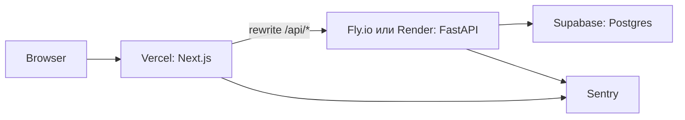

# P1 — Наружу: PaaS + CD

**Цель фазы:** приложение доступно из интернета по HTTPS, каждый merge в `main` сам уезжает на staging, релиз в prod — git tag. Это первая половина гибридного деплоя; переезд на свой VPS — P10.

Два окружения: `staging` и `prod`. У каждого своя БД (отдельный проект Supabase или отдельная база), свои секреты, свой домен.

| ID | Задача | Слой | Размер |
| -- | ------ | ---- | ------ |
| T1.1 | [Docker-образ API и локальный стек](T1.1-docker.md) | infra | M |
| T1.2 | [API на PaaS, БД на Supabase](T1.2-api-paas.md) | infra, backend | M |
| T1.3 | [Фронт на Vercel, cookie на проде](T1.3-frontend-vercel.md) | frontend, infra | M |
| T1.4 | [CD: preview, staging, prod](T1.4-cd.md) | infra | M |
| T1.5 | [Healthchecks, graceful shutdown, Sentry](T1.5-health-sentry.md) | backend, system-design | M |
| T1.C | [Challenge: учебный откат](T1.C-rollback.md) | challenge | S |
