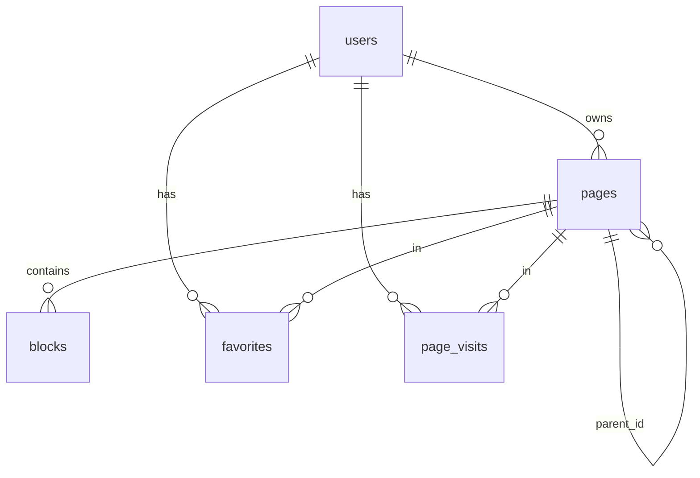

# P2 — Страницы как в Notion

**Цель фазы:** «заметка» превращается в **страницу** с вложенностью и блоками. Эта модель данных — ядро проекта до самого конца.

**Python-фокус:** async SQLAlchemy 2, `AsyncSession`, стратегии загрузки связей, generic-репозиторий (`TypeVar`, `Generic`), Pydantic discriminated unions.

**Итог фазы:** сайдбар с деревом страниц, страница из блоков с редактором на клавиатуре, корзина, быстрые списки с курсорной пагинацией, избранное и недавние.

| ID | Задача | Слой | Размер |
| -- | ------ | ---- | ------ |
| T2.1 | [Async SQLAlchemy + asyncpg](T2.1-async-sqlalchemy.md) | backend, python | M |
| T2.2 | [Дерево страниц](T2.2-page-tree.md) | backend, frontend | L |
| T2.3 | [Блоки и fractional indexing](T2.3-blocks.md) | backend, frontend | L |
| T2.4 | [Корзина: soft delete и restore](T2.4-trash.md) | backend, frontend | M |
| T2.5 | [Keyset-пагинация, фильтры, сортировки](T2.5-keyset-pagination.md) | backend, frontend | M |
| T2.6 | [Избранное и недавние](T2.6-favorites-recent.md) | backend, frontend | S |
| T2.C | [Challenge: способы хранения дерева](T2.C-tree-storage.md) | challenge | M |

Рекомендуемый порядок: T2.1 → T2.2 → T2.3 → остальные в любом порядке.
