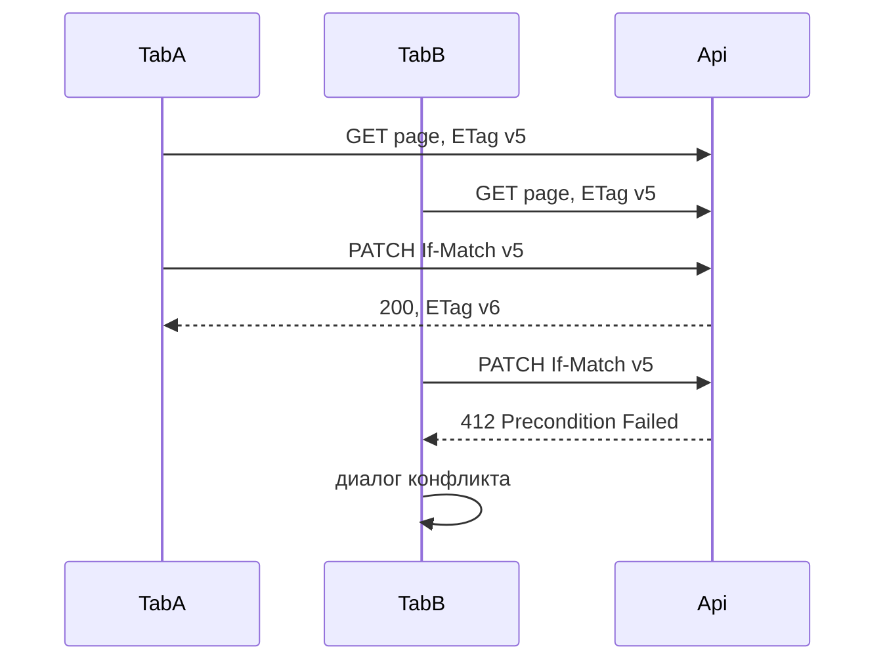

# P3 — Согласованность и конкурентность

**Цель фазы:** две вкладки, два устройства, плохая сеть, двойной клик — данные не теряются, не дублируются и не перезаписываются молча.

**Python-фокус:** контекстные менеджеры и декораторы для транзакций и ретраев, `asyncio.gather` для воспроизведения гонок в тестах.

**Итог фазы:** конфликт правок виден пользователю, повтор запроса безопасен, автосохранение переживает офлайн, у страницы есть история версий, инварианты дерева защищены от гонок.

| ID | Задача | Слой | Размер |
| -- | ------ | ---- | ------ |
| T3.1 | [Optimistic locking: ETag и If-Match](T3.1-optimistic-locking.md) | backend, frontend, system-design | M |
| T3.2 | [Idempotency-Key](T3.2-idempotency.md) | backend, system-design | M |
| T3.3 | [Автосохранение и офлайн](T3.3-autosave-offline.md) | frontend, backend | L |
| T3.4 | [История версий](T3.4-version-history.md) | backend, frontend | L |
| T3.5 | [Транзакции и уровни изоляции](T3.5-transactions-isolation.md) | backend, system-design | M |
| T3.C | [Challenge: lost update](T3.C-lost-update.md) | challenge | S |

Рекомендуемый порядок: T3.5 (теория и тестовый инструментарий для гонок) → T3.1 → T3.2 → T3.3 → T3.4.
