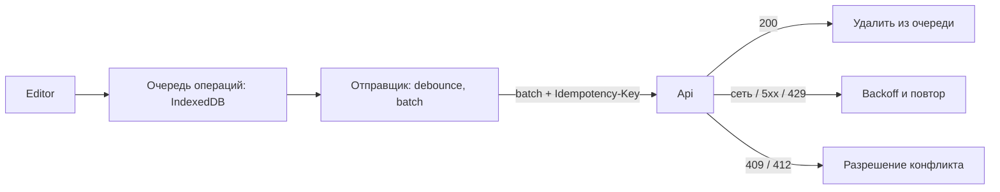

# T3.3 Автосохранение и офлайн

**Фаза:** P3 · **Слой:** frontend, backend · **Зависит от:** T3.1, T3.2 · **Размер:** L

## Контекст
В T2.3 изменения блоков отправляются batch-ом с debounce, но при ошибке сети они теряются, а пользователь не знает, сохранено ли.

## Цель
Пользователь никогда не нажимает «Сохранить» и никогда не теряет набранное: изменения копятся локально, надёжно доезжают до сервера, статус сохранения всегда виден.

## Архитектура на клиенте

1. Каждое изменение — операция с `client_op_id` (uuid) кладётся в очередь в IndexedDB (`idb-keyval` или `Dexie`). Очередь переживает перезагрузку вкладки.
2. Отправщик: debounce ~500 мс, склейка нескольких `update` одного блока в одну операцию, batch до N операций, **один** batch в полёте одновременно (порядок операций важен).
3. Ключ идемпотентности batch-а = хэш его `client_op_id` — повтор после обрыва безопасен (T3.2).
4. Ошибка сети / 5xx / 429 → экспоненциальный backoff с jitter; `online` / `offline` события браузера.
5. 409 / 412 (T3.1) → перечитать страницу, переприменить локальные несохранённые операции поверх; если операции к удалённому блоку — отбросить с уведомлением.
6. Optimistic UI: редактор показывает локальное состояние сразу; кэш TanStack Query обновляется после подтверждения.

## Backend
- Batch-эндпоинт принимает `client_op_id` у каждой операции и хранит обработанные id (таблица или поле в `idempotency_keys`) — дубль операции пропускается, а не применяется дважды.
- Ответ batch-а: новые `version` блоков, чтобы клиент обновил свои `expected_version`.
- Лимит размера batch и rate limit (позже — T5.2).

## UI
- Индикатор в шапке: «Сохранено» / «Сохраняется…» / «Офлайн — изменения сохранятся позже» / «Ошибка — повторить». Для скринридера — `aria-live="polite"`.
- `beforeunload`-предупреждение, если очередь не пуста.
- Офлайн: страница, открытая ранее, читается из кэша (persist TanStack Query в IndexedDB).

## Критерии приёмки
- [ ] DevTools → Offline, минута набора текста, Online → всё на сервере, без дублей и в правильном порядке
- [ ] Перезагрузка вкладки в офлайне не теряет несохранённое
- [ ] Обрыв соединения посреди batch-а (сервер применил, ответ не дошёл) → повтор не дублирует блоки (тест на бэке)
- [ ] Индикатор статуса корректен во всех состояниях
- [ ] Конфликт с правкой из другой вкладки разрешается без потери локального текста

## Частые ошибки
| Антипаттерн | Почему плохо |
| ----------- | ------------ |
| Несколько batch-ей параллельно | `move` может приехать раньше `insert` того же блока |
| Очередь только в памяти | закрыл вкладку — потерял |
| Повтор без идемпотентности | при обрыве после применения — дубли |
